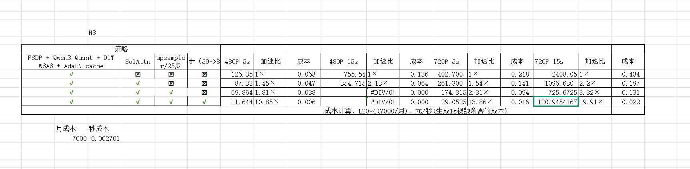

# MiniMax H3 蒸馏算法交付示例

这是 [delivery.md](../docs/delivery.md) 的填写示例，使用用户提供的 `C:\project\asset\H3-infer-eval.png`。**只有效率表中的开关、数字和费率说明来自截图；蒸馏实现、模型版本、质量、样本数和验收标准尚未提供。未提供的信息保留“待补”或 UNKNOWN，不代替实际交付结论。**

“MiniMax H3”按用户给出的项目名称使用；截图标题为 H3。以下整理不推断其公开产品规格或教师/学生模型实现。正式交付时将对应内容填入 `docs/delivery.md`，补齐真实代码、模型、配置和测评报告。

## 交付内容

| 项目 | 填写内容 |
| --- | --- |
| 交付对象 | H3 少步推理/蒸馏候选及叠加推理优化方案；具体蒸馏实现待补 |
| 功能场景 | 根据原图，比较 480P/720P、5s/15s 的视频生成工况；输入类型待补 |
| 输入 / 输出接口 | 待补：输入模态、prompt/条件长度、输出宽×高、帧率、编码格式 |
| 教师 / 学生模型 | 待补：教师和学生 checkpoint、训练方式、loss、训练配置与任务 |
| 交付代码 / 模型 / Owner / 日期 | 待补；源图片不能确定这些版本与责任信息 |
| 使用入口 | 填写 [code/location.yaml](../code/location.yaml) 的代码根目录、训练/推理/评测入口 |
| 当前结论 | 有效率数字可供整理，但质量、计时口径与复现证据不足，整体交付为 UNKNOWN |

## 原始效率表

仓库内保留原图副本，复制模板到其他目录后仍可阅读：



下面的时间数值直接转录自图中各工况列。**原图未明确标注耗时单位或统计量。示例按秒解释，因为与图中的成本折算一致；正式交付仍须确认它是秒、计时范围以及均值/中位数/单次结果。** 原图的成本说明为“元/秒（生成 1s 视频所需的成本）”，即元/生成视频秒，不是元/视频。

## 优化策略与对照

用 R0–R3 标识原图四行，以免将多个开关的叠加收益写成某一个算法的收益。

| 方案 | 定位 | FSDP + Qwen3 Quant + DiT W8A8 + AdaLN cache | SolAttn | upsampler / 25 步 | 50→8 步选项 |
| --- | --- | --- | --- | --- | --- |
| R0 | 图中的 baseline | 未启用 | 未启用 | 未启用 | 未启用 |
| R1 | 组合优化 | 启用 | 启用 | 未启用 | 未启用 |
| R2 | R1 + 上采样策略 | 启用 | 启用 | 启用 | 未启用 |
| R3 | R2 + 少步候选 | 启用 | 启用 | 启用 | 启用 |

“upsampler / 25 步”和“50→8 步”按图中列名整理。正式交付还要区分主模型步数、上采样阶段步数以及该开关是否切换蒸馏权重；不能仅凭开关名补写蒸馏方法。

R0→R1 同时开启组合优化与 SolAttn，不能据此分离量化、缓存和 SolAttn 的贡献。R0→R3 的数字是整套候选相对 baseline 的累计收益。若需要声称“蒸馏本身的收益”，应在固定其他配置与质量要求后对比对应方案，并补版本证据。

## 公共测试条件

| 项目 | 截图可知 / 需要补充 |
| --- | --- |
| 工况 W1 / W2 / W3 / W4 | 480P/5s、480P/15s、720P/5s、720P/15s；宽×高、帧率、帧数待补 |
| 硬件与费用说明 | 原图成本备注为 L20×4、7000 元/月；是否各行实际均用四卡、7000 是单卡还是四卡整机费用待确认 |
| 输入、prompt、随机种子、固定评测集 | 待补 |
| 模型/代码/配置版本 | 待补：R0–R3 各自版本与可复现参数 |
| 精度和优化实现 | 部分开关见策略表；其余模块精度、FSDP 并行配置、缓存规则待补 |
| 内部计算尺寸与上采样条件 | 待补，需说明最终输出规格一致时内部尺寸的变化 |
| batch / 并发 / 环境 | 待补 |
| 计时边界与 GPU 同步 | 待补：是否含预处理、主模型、解码、上采样、I/O、加载/编译 |
| 样本数 / 预热 / 重复 / 统计量 / 波动 | 待补，不把截图数字自行称为 p50 或平均值 |
| 峰值显存、服务吞吐和失败率 | 待补，不能从单个时间数值推断实际服务产能 |
| 同评测集质量 / 退化 / 困难 case | 待补 |

## 效率结果整理

加速比与成本保留原图展示精度，时间保留图中的有效数字。单元格“未测”对应原图空耗时及其错误衍生值；其他数字表示**截图报告的结果**，并非本示例重新运行所得。质量和复现条件未补齐前，各工况的正式效率验收为 UNKNOWN。

| 工况 | 方案 | 原图耗时（按 s 解读，统计量待补） | 原图累计加速比（相对本工况 R0） | 原图成本（元/生成视频秒） | 同口径质量 |
| --- | --- | --- | --- | --- | --- |
| W1：480P/5s | R0 | 126.35 | 1.00× | 0.068 | UNKNOWN |
| W1：480P/5s | R1 | 87.33 | 1.45× | 0.047 | UNKNOWN |
| W1：480P/5s | R2 | 69.864 | 1.81× | 0.038 | UNKNOWN |
| W1：480P/5s | R3 | 11.644 | 10.85× | 0.006 | UNKNOWN |
| W2：480P/15s | R0 | 755.54 | 1.00× | 0.136 | UNKNOWN |
| W2：480P/15s | R1 | 354.715 | 2.13× | 0.064 | UNKNOWN |
| W2：480P/15s | R2 | 未测 | 未测 | 未测 | UNKNOWN |
| W2：480P/15s | R3 | 未测 | 未测 | 未测 | UNKNOWN |
| W3：720P/5s | R0 | 402.700 | 1.00× | 0.218 | UNKNOWN |
| W3：720P/5s | R1 | 261.300 | 1.54× | 0.141 | UNKNOWN |
| W3：720P/5s | R2 | 174.315 | 2.31× | 0.094 | UNKNOWN |
| W3：720P/5s | R3 | 29.0525 | 13.86× | 0.016 | UNKNOWN |
| W4：720P/15s | R0 | 2408.05 | 1.00× | 0.434 | UNKNOWN |
| W4：720P/15s | R1 | 1096.630 | 2.20× | 0.197 | UNKNOWN |
| W4：720P/15s | R2 | 725.6725 | 3.32× | 0.131 | UNKNOWN |
| W4：720P/15s | R3 | 120.9454167 | 19.91× | 0.022 | UNKNOWN |

W2/R2 和 W2/R3 的原图加速比为 `#DIV/0!`，成本为 `0.000`。这两个值由缺失耗时引起，应保留未测状态，**不能解释成耗时为零、免费生成或已测完成**。

表中没有显存、逐次计时和质量结果；完整交付应按通用模板补齐，不从本表猜测。

## 成本推导：说明分母和假设

为了核算图中成本，本段暂作如下假设：耗时单位为秒；7000 元是 L20 四卡整机的月费；一个月按 30 天、资源连续占满计；每次生成一个视频。**这些是假设，不是截图已经提供的全部测试事实。** 需确认单卡/整机和实际计费规则后再用于正式交付。

```text
r = 7000 / (30 × 24 × 3600) = 0.002700617… 元/整机计算秒
元/视频 = r × T
元/生成视频秒 = r × T / L
```

原图展示的秒成本为 `0.002701`，与上述折算近似一致。它已经按整机费率解释，不再乘 4。计算使用未四舍五入的费率，最后再保留结果精度；下面的“元/视频”也直接由耗时计算，不从已经取整的“元/生成视频秒”反推。

| 工况 | R0→R3 时间（s，单位假设待确认） | 重算加速比 | 耗时降低比例 | R0→R3 成本（元/视频，假设折算） | R0→R3 成本（元/生成视频秒，假设折算） |
| --- | --- | --- | --- | --- | --- |
| 480P/5s | 126.35→11.644 | 10.85× | 90.78% | 0.3412→0.0314 | 0.0682→0.0063 |
| 480P/15s | 755.54→未测 | 未测 | 未测 | 2.0404→未测 | 0.1360→未测 |
| 720P/5s | 402.700→29.0525 | 13.86× | 92.79% | 1.0875→0.0785 | 0.2175→0.0157 |
| 720P/15s | 2408.05→120.9454167 | 19.91× | 94.98% | 6.5032→0.3266 | 0.4335→0.0218 |

这是依据截图数字的算术核对。它不证明质量等价、端到端边界一致或实际账单降低相同比例。利用率、失败重试、闲置、蒸馏训练和存储/网络等费用尚未计入；上线服务应另给实际计费或完整成本口径。

在资源与计时方法一致的前提下，可补充 R2→R3 的增量时间比：W1 为 6.00×，W3 为 6.00×，W4 为约 6.00×。但由于缺少模型版本与质量结果，这仍不能独立证明蒸馏的因果贡献。

## 量化效果与验收

正式项目在开始前约定阈值。本图未提供效果或阈值，下面展示交付检查的结构，不事后用已知速度设定“恰好达标”的标准。

| 验收项 | 必需证据 | 本例已有内容 | 判定 / 待补 |
| --- | --- | --- | --- |
| 算法功能 | 输入输出接口、支持场景与使用测试 | 四种输出工况名称 | UNKNOWN：接口和功能记录缺失 |
| 模型质量 | 固定评测集，教师/baseline 与学生质量、退化阈值 | 未提供 | UNKNOWN |
| 关键 case / 稳定性 | 困难样例、人评口径、失败率 | 未提供 | UNKNOWN |
| 推理效率 | 端到端绝对时间、同工况 baseline、统计方法与资源 | 部分工况截图时间与加速比 | UNKNOWN：计时条件缺失，480P/15s 候选未测 |
| 资源与成本 | 显存、完整费率和计费假设 | L20×4、7000/月及近似成本 | UNKNOWN：资源与计费主体需确认 |
| 可复现交付 | 代码 SHA、配置、模型/数据版本和原始报告 | 仅截图 | UNKNOWN |

## 过程与资产交付

将真实资产登记到 [assets.yaml](../assets.yaml)，并在本表引用其 ID。下面的文字是填写要求，不是已存在的资产。

| 资产 | 应填写的内容 | 本例状态 |
| --- | --- | --- |
| 蒸馏代码与固定 SHA | 仓库 URL、教师/学生训练实现、运行时的完整提交 | 待补 |
| 本机代码位置 | code/location.yaml；外部仓库按 code/README.md 配置本机覆盖路径 | 模板已提供，实际目录由使用者填写 |
| 模型与训练配置 | 教师、学生 checkpoint/校验和，loss 与训练参数 | 待补 |
| 推理配置 | R0–R3 各自精度、步数、量化、注意力、缓存、上采样配置 | 仅开关概要可从截图读取 |
| 数据与固定评测集 | URI、不可变版本、manifest、种子/样本列表 | 待补 |
| 原始测量与质量报告 | 每次计时、环境、质量结果、错误/重试记录 | 待补；截图不足以代替原始日志 |
| 运行任务、关键实验与决策 | DLC/其他任务、EXP/ADR、Owner 确认 | 待补 |

## 复现步骤

1. 根据 `code/location.yaml` 找到代码目录；外部仓库填 `repo_asset_id` 和本机 `path`，核对代码真实 SHA。
2. 获取固定教师/学生模型、数据与配置，填写训练、推理、评测入口，以及环境/依赖版本。
3. 在同一环境下对 W1–W4 分别跑 R0–R3，明确预热、计时同步和样本/重复规则；耗时边界含哪些阶段需记录。
4. 保存原始时间与质量记录，补测 W2/R2、W2/R3，收集峰值显存和失败率。
5. 使用同口径统计量重算加速比，按明确的计费主体核算成本，再逐项判断是否满足事先约定的标准。

实际命令、参数与工作目录待代码提供后填写，不虚构一个本仓库没有实现的运行脚本。

## 这个示例应该怎样汇报

**可以表述：**“截图中，720P/15s 工况的 R0→R3 数值为 2408.05→120.9454167，累计时间比为 19.91×；若时间以秒计，则约为 40.13 分钟→2.02 分钟。480P/15s 的 R3 未测。质量与正式复现条件仍待补充。”

**会被要求补证据的表述：**“H3 蒸馏已经无损加速 20 倍、四种规格全部完成、成本下降 95%，可以上线。”其中单项归因、无损质量、完整工况和生产成本都没有足够证据。

## 已知限制与确认

- 当前缺少蒸馏实现、效果、资源测量、计时口径、版本和原始记录。
- 480P/15s 的后两组缺测；空值造成的错误公式需要修正。
- 不同工况的加速比不同，不能概括为所有输入固定“20 倍”。
- Owner / 使用方确认人和日期：待补。
- 整体审核：UNKNOWN；未设置交付关闭状态，不更新实际项目 `goal.current` 或 `outcome`。
